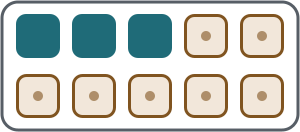

## Hva er tiervenner? {#what}

**Tiervenner** er to tall som til sammen blir 10. For eksempel er 3 og 7 tiervenner, fordi $3 + 7 = 10$.

Ordet brukes mye i norsk skole, men det er ikke en ny type regning. Det er bare et navn på tallpar som fyller opp en tier. På engelsk heter det *number bonds to ten*.

## Alle tiervennene {#pairs}

Det finnes bare seks par, så de er mulige å lære seg:

| Par | Regnestykke |
| 0 og 10 | $0 + 10 = 10$ |
| 1 og 9 | $1 + 9 = 10$ |
| 2 og 8 | $2 + 8 = 10$ |
| 3 og 7 | $3 + 7 = 10$ |
| 4 og 6 | $4 + 6 = 10$ |
| 5 og 5 | $5 + 5 = 10$ |

Rekkefølgen spiller ingen rolle: $9 + 1$ gir det samme som $1 + 9$.

## Utforsk i en tierramme {#ten-frame}

En **tierramme** er et rutenett med 10 plasser, i to rader med fem. De tomme plassene viser hvor mange som mangler til 10. Velg et tall og se hvilken tiervenn det har.

:::visual{type="ten-frame-explorer" start="3"}
:::

## Hvorfor er det nyttig? {#why}

Det er lett å regne videre fra 10. Hvis du først fyller opp til 10, blir resten av regnestykket enklere.

:::example{title="Gjennomgått eksempel: 8 + 5" id="example"}
1. 8 trenger 2 for å bli 10. (8 og 2 er tiervenner.)
2. Del 5 i 2 og 3.
3. Legg 2 til 8. Da har du 10, og det er 3 igjen.

$$8 + 5 = 8 + 2 + 3 = 10 + 3 = 13$$
:::

Gå gjennom eksemplet ett steg om gangen. Bildet, regnestykket og teksten viser det samme steget.

:::visual{type="make-ten" a="8" b="5"}
:::

## Prøv i tankene {#try}

- $9 + 4$: 9 trenger 1. Del 4 i 1 og 3. Da blir det $10 + 3$.
- $7 + 6$: 7 trenger 3. Del 6 i 3 og 3. Da blir det $10 + 3$.
- $6 + 5$: Hvilken tiervenn har 6? Hvor mye er igjen av 5?

Du trenger ikke alltid gå veien om 10. Hvis du ser svaret på en annen måte, er det like riktig.

## Øv {#practice}

:::practice{skill="arithmetic.add-within-20" variant="within-10"}
:::

:::practice{skill="arithmetic.add-within-20" variant="across-10"}
:::
