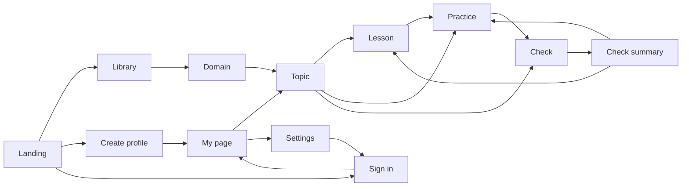

# MathKX — proposed build brief

**Reviewer:** Claude Fable 5.1, slug `claude-fable`. **Date:** 2026-10-18. **Baseline:** `b6c4548d890979c5327d729e13a27efee20814b8`.
**Status: proposed.** This is one coherent starting design for the owner to accept, adapt, or reject. It does not change requirements or accepted ADRs. Recommendation IDs refer to [recommendations.md](recommendations.md); evidence is in [analysis.md](analysis.md).

---

## 1. Learner, problem, first useful outcome

**Primary learner.** A fourteen-year-old who finds parts of mathematics difficult, using an iPad, in Norwegian, with a parent nearby who reads English. Secondary: an adult relearning the basics without wanting to feel like a child.

**Problem.** When they get something wrong, the tools they have say "wrong" and move on. They cannot ask for the picture before they fail, and nothing explains what probably went wrong.

**First useful outcome.** The learner opens a lesson, chooses to see the visual model *before* answering, answers, gets feedback that names the likely slip, asks for another question or an easier one, and finishes a short check whose summary distinguishes what they did alone from what they did with help. In both languages. On their iPad. With their work kept if they rotate the device or switch language.

---

## 2. First-weekend vertical slice

### Scope

One topic, end to end, for real:

| Element | Scope |
| --- | --- |
| Skills | `numbers.addition-within-10`, `numbers.number-bonds-to-ten`, `numbers.addition-crossing-ten` (names per R01-001; three skills, two prerequisite edges) |
| Lesson | "Number bonds to ten" from the prototype, moved to `content/lessons/number-bonds-to-ten/{nb,en}.md`, rendered by the real app with the ten-frame explorer and the make-ten example embedded (R01-005) |
| Exercise family | `addition-within-20`, version 1, generated from `(seed, variant)` with variants `within-10`, `crossing-ten`, `within-20` (R01-003, R01-004); plus the prototype's five fixed questions kept as one authored set to prove fixed content works |
| Visual help | Two-group counters for sums ≤ 10, make-ten frame for sums > 10, on request before answering, stepwise, no drag (prototype components, ported) |
| Practice | "Another question", "Make it easier", "More challenge" with one-sentence descriptions; work preserved; variant recorded |
| Check | Four generated questions, support policy stated first, feedback withheld until the summary, three-group summary with links to lesson sections |
| Progress | Guest only, in the browser, shaped as the attempt and progress contracts of R01-002 so a server can take them unchanged later |
| Languages | Norwegian Bokmål and English for everything above, with the key-parity test (R01-006) |
| Devices | Works at 390, 820, and 1180 px wide in the browser; one physical-iPad pass of the checklist (R01-009) at the end of the weekend |

### Observable completion criteria

1. `dotnet test` passes: SplitMix64 fixtures from the proposal, golden seeds for all three variants, a 10,000-seed property test, and generator–validator agreement.
2. `npm run validate` resolves the lesson's skills and both language files; `npm test` passes.
3. In the running app, in each language: open the lesson, open the ten-frame, go to practice, press "Show visual help" before typing, type `8`, switch language, see `8` still there, submit, see "Correct. 4 + 4 = 8" and the help note, press "Another question", press "Make it easier" and see "Next: addition within ten".
4. Start a check, use help on one question, skip one, finish, and see independent / with help / revisit groups with the correct answers only in the revisit group.
5. Rotate (or resize) mid-exercise with help open: answer and help state survive.
6. An attempt stored in the browser contains family ID, version, seed, variant, purpose, support events, and a typed result.
7. One iPad checklist completed and its findings filed as issues.

### Why this slice and not the plausible alternatives

- **One-step equations first.** Closer to the fourteen-year-old's level and the balance component exists. Rejected for the *first* weekend because `x + a = b` has almost no variant ladder, so "Make it easier" cannot be demonstrated honestly, and the answer form (`x = 4`) adds parsing decisions. It is weekend two: the same shell, a second family, which is the real test that the contracts are domain-independent.
- **Pythagoras with a square-roots detour (the older prototype).** Richer mathematics and the original motivation. Rejected for now: needs square roots, decimals, a geometry representation, and either a routing rule or a manual detour design. The detour-and-return idea returns in weekend three or later as a manual "return to goal" affordance (analysis W3).
- **The capability model's recommended slice (choice, scalar, ordering, one spatial interaction).** The right target for Format v1, too wide for a weekend. This brief proves scalar response, authored and generated content, hints as coded feedback, typed results, and evidence provenance from that list, and defers choice (cheap to add), ordering, and spatial. The deviation is deliberate and should be recorded in the decision log.
- **Addition is below the learner's level.** True. The slice is about proving the loop and the contracts; the learner-value test comes with the second family. Saying this plainly avoids disappointment next weekend.

---

## 3. First public release (separate scope)

Nothing below disappears because the slice is small.

| Area | Release requirement |
| --- | --- |
| Content | At least the two prototype topics complete in both languages: lesson, generated family, help, check; the library opens on ready topics with a start suggestion (R01-010) |
| Profiles | Server-side profiles per the design in R01-007: email-free sign-in, hashed credentials, rate limiting, optional verified email, optional recovery codes, explicit device sessions, deletion, export; guest-to-profile merge prompt (R01-008) |
| Progress | Durable server storage of the attempt and progress contracts; language switch and device change preserve progress |
| Bilingual | CI enforcement of dictionary parity and lesson pairing; no untranslated literal (R01-006) |
| iPad and accessibility | Checklist passed on a physical iPad in Safari with VoiceOver and an external keyboard, both languages, recorded device/OS versions (R01-009) |
| Contribution | Licenses and terms published; issue template wired to "Suggest an improvement"; lessons under `content/` with validation; CONTRIBUTING describes the real path (R01-012, R01-001, R01-005) |
| Privacy | Plain-language notice in both languages; no analytics that profile learners |
| Hosting | Decided and documented; HTTPS; backups of progress |
| Honesty | No mastery number anywhere; activity labels only, until a mastery model is validated |

---

## 4. Screen map and one journey



The prototype's routes already match this map. The slice keeps them and adds no screens.

**One journey (Norwegian, iPad, guest):** Landing → "Begynn å lære" → Library (opens on ready topics; "Usikker? De fleste begynner med Addisjon innenfor 20") → Topic (what you will understand, lesson card, practice, check, "nyttig å kunne fra før") → Lesson (reads two sections, plays with the ten-frame, steps through 8 + 5) → "Start øving" → `4 + 4`: presses "Vis visuell hjelp", counts, types 8, submits, reads the feedback → "En oppgave til" → `7 + 6`: wrong answer 12, reads "Nesten. Svaret ligger rett ved 12" → "Gjør det enklere" → "Neste: addisjon innenfor ti" → three more → "Sjekk forståelsen min" → policy screen → four questions, help on one → summary: 2 alene, 1 med hjelp, 1 verdt å se på igjen, with a link to "Hvorfor er det nyttig?" → "Lag en profil hvis du vil lagre resultatet" (release: creates profile and keeps the work).

---

## 5. Conceptual data flow and responsibility boundaries

```text
content/lessons/*.md ──render──▶ Web app (React, Designsystemet, Tailwind)
content/skills/*.json              │  shows prompt, help, controls; emits response artifact
content/exercises/*.json           │  resolves feedback codes to nb/en text
        │                          ▼
        │                 Domain API (ASP.NET Core)
        │                   GET  instance(family, version, seed, variant) ──▶ presentation + private data kept server-side
        │                   POST validate(instanceRef, artifact)          ──▶ ValidationResult {status, code, values, validatorVersion}
        ▼                          │
 .NET Domain library ◀─────────────┘
   SeededRandom (SplitMix64), AdditionWithin20 generator, scalar validators, misconception codes
   no UI, no text, no I/O; fully tested

 Browser (slice) / Server (release): Progress store
   Attempt {instanceRef, purpose, artifact, result, support[], at}
   Progress {lessonsExplored, attempts[], last}
```

**Who decides what.**

- **Content** names skills, lessons, families, variants, help model, and texts. It never computes.
- **Domain** generates, validates, and emits codes. It never renders or localises.
- **Web app** renders, records support events, applies learner controls, and localises. It never decides correctness.
- **Progress store** keeps attempts as given. It never interprets them as mastery.

Names above (`instanceRef`, `ValidationResult`, `variant`) are working names for the slice, not accepted contracts. Format v1 should be written from what the slice actually needed.

---

## 6. Implementation sequence, deferrals, prototype reuse

### Dependency-ordered sequence

1. **Decisions D1–D4 (section 8)**, half a day of owner time, before Saturday.
2. **Content reconciliation (R01-001, R01-005):** six skill files, lesson moved and tables fixed, validator extended for lessons. Half a day. Everything else depends on the IDs.
3. **Domain library and tests (R01-004, R01-002):** `src/backend/MathKX.Domain` and `MathKX.Domain.Tests`: SplitMix64 with the proposal's fixtures, variants, generator, validator with codes, result and attempt records. One day. No UI until this is green.
4. **Thin API:** two endpoints, instance and validate, in `src/backend/MathKX.Api`. Private validation data never leaves the server. Two hours.
5. **Web app skeleton:** Vite + React + TypeScript + Designsystemet + Tailwind with the prototype's `styles.css` layer order; port `ExerciseShell`, `Counters`, `TenFrame`, `MathExpr`, `Page`, i18n dictionaries with the literals fixed (R01-006). Half a day.
6. **Lesson rendering** with a standard Markdown library plus the directive for components. Half a day.
7. **Practice controls and check** (R01-003) wired to variants and seeds. Half a day.
8. **Browser progress store** with the attempt shape; "Lesson explored" and activity labels from `activity.js`. Two hours.
9. **CI:** `dotnet test`, `npm test`, `npm run validate`, web build. One hour.
10. **iPad checklist pass** (R01-009). One hour plus fixes.

That is roughly two and a half days of focused work; a weekend covers 1 to 8 if the decisions are made beforehand, with 9 and 10 the following evenings. If time runs short, cut the check (keep practice) before cutting the controls or the second language.

### Defer

Profiles and server storage (release), one-step equations (weekend two), choice and ordering responses, symbolic entry, prerequisite detour, mastery, Format v1 schema work, a mathematics keyboard, TypeScript twin of the random source, Nynorsk.

### From the prototype: retain, port, replace

| Prototype piece | Decision |
| --- | --- |
| `ExerciseShell.jsx`, `Counters.jsx`, `TenFrame.jsx`, `MathExpr.jsx`, `Page.jsx`, `App.jsx` shell, `styles.css`, theme tokens | **Port** largely unchanged into the TypeScript app |
| `domain/math.js` | **Replace** with the .NET domain; keep its codes and texts as the first feedback catalogue |
| `store.jsx` profiles, toy hash, fixed email code | **Discard**; design per R01-007 |
| `store.jsx` work/sets/checks session state | **Port** the idea (session storage survives rotation and language switch) |
| `Markdown.jsx` | **Replace** with a standard parser plus directive extension (R01-005) |
| `catalog.js` domains and topics | **Port** as content data; fixed question lists become one authored set |
| Lessons (`*.nb.md`, `*.en.md`) | **Move** to `content/lessons/` with delimiter rows added |
| `activity.js` | **Port** as is |
| Hash routing | **Replace** with real routes once the app has a server |
| Older prototype | **Archive** (R01-011) |

---

## 7. Critical decisions before starting

Only these four block the slice. Each has a recommendation and the evidence that would change it.

| ID | Question | Options | Recommendation | What would change it |
| --- | --- | --- | --- | --- |
| D1 | Skill ID scheme and first skills | (a) keep `numbers.`/`algebra.` registry prefixes and add the slice skills; (b) adopt the prototype's `arithmetic.` prefixes | **(a)**, because it is validated and merged | An owner preference for `arithmetic.`; either works, deciding matters |
| D2 | Where mathematics runs in the slice | (a) .NET domain + thin API from day one; (b) TypeScript domain in the browser now, port to .NET later | **(a)**; the release needs a server anyway (ADR 0006), and (b) is a stated-stack change that would need owner agreement and risks two implementations | If the weekend cannot include any backend setup, (b) with the proposal's fixtures as the shared test suite is the honest fallback, labelled as a temporary requirement deviation |
| D3 | Lesson dialect for the slice | (a) GFM + front matter + `:::` directives via a standard parser; (b) keep the prototype's hand-written dialect; (c) MDX | **(a)** (R01-005) | A teacher preferring `{{component}}` after trying both; (c) would be a requirement change |
| D4 | First family and topic | (a) addition within 20; (b) one-step equations; (c) Pythagoras | **(a)** this weekend, **(b)** next | If the owner wants the learner to see their own level on day one, start with (b) and accept that "Make it easier" is demonstrated later |

### Stated assumptions (not blocking; say so if wrong)

- Norwegian means Bokmål; English uses British spelling as the prototype does ("practise"). Regional conventions are not decided by this.
- The slice stores progress only in the browser, with the attempt shape ready for a server.
- SplitMix64 is adopted if and only if its fixtures pass in C#; acceptance as an ADR is a separate owner step.
- Designsystemet and Tailwind integration follows the prototype's `styles.css` until a visual regression test says otherwise.
- The repository layout follows `architecture.md`: `src/backend/`, `src/web/`, `tests/` only if something needs it.
- No profile code is written this weekend.

---

## 8. Validation plan

| When | Who | What | Pass looks like |
| --- | --- | --- | --- |
| End of weekend one | Owner, on a physical iPad in Safari | R01-009 checklist on the slice, both languages, with VoiceOver for the exercise screen | Checklist completed; issues filed; nothing blocks the second weekend |
| Weekend two | The fourteen-year-old | One-step equations family in Norwegian, 20 minutes, think-aloud if willing; watch whether "Vis visuell hjelp" is pressed before or after a wrong answer, and whether the activity labels read as progress | Help is used at least once by choice; the learner can say what "Svarte med hjelp" means |
| Weekend two | One adult who did not grow up with "tiervenner" | The number-bonds lesson in English, then five practice questions | No reaction to the stage label as "childish"; the lesson's framing sentence is noticed |
| Before release | A mathematics educator | Review both lessons, the misconception codes and their texts, and the check policy copy | Written review in an issue; codes judged plausible, not overclaiming |
| Before release | One contributor who has not seen the repository | Fix a wording in one language of one lesson, run validation, open a pull request, and file a "Suggest an improvement" issue from the app | Completed without touching application code; CI result understood |
| Before release | Owner plus one screen-reader user if available | Full journey on iPad with VoiceOver and an external keyboard | Checklist passed; device and OS recorded |

Models reviewing one another do not substitute for any row above.

---

## 9. Risks and verdict

### Remaining risks

- **Scope creep into weekend one.** Mitigation: the cut order in section 6 (check first, then nothing else; never the second language or the controls).
- **Backend setup eats the weekend.** Mitigation: D2 fallback is defined; the domain tests are the deliverable either way.
- **The dialect decision stalls on taste.** Mitigation: convert both lessons both ways in an hour and pick.
- **Profiles get improvised under pressure in weekend two or three.** Mitigation: R01-007 written before any account code; no account code in the first two weekends.
- **iPad surprises (keyboard covering the field, MathML in Safari).** Mitigation: the checklist runs on the prototype build this week, before the slice, so known issues are known.
- **Anchoring.** This brief was written by the same model that wrote the historical review; a second reviewer's report and the focused challenge pass in `review-process.md` are the mitigation.

### Verdict

**Ready for the proposed slice subject to the four named decisions (D1–D4).** The documentation is coherent, the prototype supplies most of the UI and the feedback catalogue, the content tooling exists, and the domain contracts are small. **Not ready for a public release**, with specific blockers: no profile design (R01-007), no device or assistive-technology validation (R01-009), no license or contribution terms (R01-012), and no translation enforcement (R01-006).
